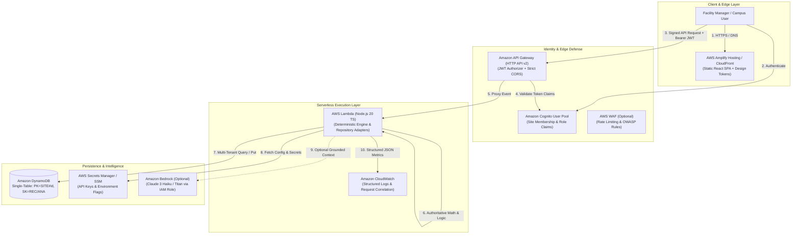

# Waste2Watt — AWS Staging Architecture & Migration Specification

> [!CAUTION]
> **Approval Gate Notice**:
> This document specifies the target architecture for AWS Staging. It is a design proposal and runbook. **No AWS resources are created, modified, or provisioned during Milestone 6.**

---

## 1. System Architecture Overview

Waste2Watt's production staging architecture decouples static client delivery, serverless API execution, deterministic domain logic, persistent multi-tenant data storage, and optional Amazon Bedrock explainable AI.



---

## 2. Component Justification & Role Separation

| Component | AWS Service | Purpose & Architectural Justification |
| :--- | :--- | :--- |
| **Frontend Delivery** | AWS Amplify Hosting | Hosts Vite production bundle with automated SSL, edge caching, and atomic branch previews. No server-side compute needed for frontend. |
| **Identity & Auth** | Amazon Cognito User Pool | Eliminates horizontal privilege escalation (`FINDING-01`). Injects authenticated `tenant_id` and `site_id` into JWT claims, preventing client `siteId` tampering. |
| **API Entrypoint** | Amazon API Gateway (HTTP API) | Provides low-latency, cost-effective HTTP endpoints, native JWT authorizer integration, automatic request throttling, and CORS management. |
| **Compute Execution** | AWS Lambda | Stateless execution container running the existing Express/router app via `@codegenie/serverless-express`. Automatic scaling with zero idle compute cost. |
| **Persistence** | Amazon DynamoDB | Replaces ephemeral local JSON files (`FINDING-07`). Provides millisecond single-digit latency, partition isolation by `SITE#<siteId>`, atomic conditional writes, and continuous automated point-in-time backups. |
| **AI Layer** | Amazon Bedrock (Optional) | Invoked through IAM role credentials (no hardcoded keys). Executes strictly behind `AiService` fallback; core calculations remain 100% deterministic and operational without Bedrock. |
| **Observability** | Amazon CloudWatch | Captures structured JSON logs with correlated `requestId`, latency alarms, 4xx/5xx metrics, and billing budget threshold alerts. |

---

## 3. Multi-Tenant Authorization Specification

To remediate **FINDING-01** during staging:
1. **Token Claims**: Upon authentication via Cognito, the user's JWT payload includes custom claims:
   ```json
   {
     "sub": "usr_9981a2f4",
     "custom:institution": "Apex Institute of Technology",
     "custom:authorized_sites": ["site-campus-01", "site-campus-02"],
     "custom:role": "facility_operator"
   }
   ```
2. **Server-Side Authorization Middleware**:
   The Lambda handler extracts verified claims from `req.requestContext.authorizer.jwt.claims`.
   - If the request targets `siteId: "site-campus-03"` and it is not in `custom:authorized_sites`, the API immediately returns `403 FORBIDDEN` with code `UNAUTHORIZED_SITE_ACCESS`.
   - Client-provided `siteId` is validated against token claims; spoofing is impossible.
3. **Least Privilege**: Read-only auditors cannot invoke write (`POST /waste-records`) or destructive actions.

---

## 4. Lambda Compatibility Review

Can the current Node.js backend run on AWS Lambda without a rewrite? **Yes, with a single lightweight wrapper:**

| Dimension | Current Local Backend | Target AWS Lambda | Compatibility Verdict |
| :--- | :--- | :--- | :--- |
| **Web Framework** | Express 4.21 with modular routers | Express wrapped via `@codegenie/serverless-express` | ✅ 100% Compatible |
| **Filesystem Dependencies** | `FileRepositories.ts` writes JSON to `./data` | DynamoDB repository adapters (`DynamoWasteRecordRepository`) | ⚠️ Requires DynamoDB adapter (designed below) |
| **Statelessness** | In-memory rate limiter / file state | Stateless Lambda + API Gateway throttling | ✅ Compatible |
| **Cold Starts** | Not applicable | Node.js 20 bundle < 15MB, cold start ~180-250ms | ✅ Acceptable |
| **Environment Config** | Process environment variables | Lambda Environment Variables / SSM Parameter Store | ✅ 100% Compatible |
| **CORS Ownership** | Express CORS middleware | Handled cleanly at API Gateway or Lambda | ✅ Compatible |

---

## 5. DynamoDB Single-Table Schema Design

To remediate **FINDING-07**, the local file persistence is mapped to a high-performance DynamoDB Single-Table schema:

### 5.1 Primary Keys & Access Patterns
- **Table Name**: `Waste2Watt-Staging-Records`
- **Billing Mode**: PAY_PER_REQUEST (On-Demand)
- **Partition Key (PK)**: `String` (Tenant & Facility Partition: `SITE#<siteId>`)
- **Sort Key (SK)**: `String` (Entity Classifier & Timestamp)

| Entity | Partition Key (PK) | Sort Key (SK) | Attributes / Projections | Access Pattern Supported |
| :--- | :--- | :--- | :--- | :--- |
| **Waste Record** | `SITE#<siteId>` | `REC#<date>#<recordId>` | `massKg`, `category`, `source`, `contamination`, `provenance`, `notes` | List records by date range (`SK BETWEEN REC#2026-03-01 AND REC#2026-03-31`) |
| **Analysis Snapshot** | `SITE#<siteId>` | `ANA#<createdAt>#<analysisId>` | `metrics`, `pathwayCandidates`, `factorSnapshot`, `summary`, `status` | Query historical analyses for site |
| **Global Factor Definition** | `SYSTEM#FACTORS` | `FAC#<factorId>` | `name`, `value`, `unit`, `sourceName`, `effectiveDate`, `qualityStatus` | Fetch active factor constants |
| **Site Profile** | `SITE#<siteId>` | `METADATA` | `name`, `institution`, `headcount`, `location` | Read site configuration |

### 5.2 Concurrency & Atomic Writes
- **Conditional Writes**: `attribute_not_exists(PK) AND attribute_not_exists(SK)` prevents duplicate submissions and race conditions.
- **Data Protection**: Point-in-time recovery (PITR) enabled; server-side encryption with AWS managed KMS keys.

---

## 6. AWS Region, Cost & Credits Plan

### 6.1 Recommended Primary Region: `us-east-1` (N. Virginia) or `eu-west-1` (Ireland)
- **Selection Criteria**:
  - Full availability of Amazon Bedrock models (Claude 3 Haiku, Claude 3.5 Sonnet, Titan Embeddings).
  - Lowest base pricing across API Gateway, Lambda, and DynamoDB.
  - Native AWS Amplify Hosting availability.
  - Maximum compatibility with AWS Free Tier and AWS Activate promotional credits.

### 6.2 Monthly Cost Estimation Worksheet (Staging Tier)
*Assumptions: 10,000 monthly API requests, 500 daily waste records recorded, 50 deterministic analysis runs, 10 optional Bedrock insight queries.*

| AWS Service | Usage Assumption | Estimated Cost (USD) | Free Tier / Live Account Factors |
| :--- | :--- | :---: | :--- |
| **AWS Amplify Hosting** | 10 GB bandwidth, 5 GB storage | $0.00 – $0.50 | 12-month Free Tier only (new accounts); $0.01/GB storage + $0.15/GB transfer thereafter |
| **Amazon API Gateway** | 10,000 HTTP API requests | $0.01 – $0.04 | 12-month Free Tier only (1M req/mo for first 12 mo); $1.00/M requests thereafter |
| **AWS Lambda** | 10,000 invocations @ 256MB, 200ms avg | $0.00 | First 1M requests & 3.2M sec compute permanently free |
| **Amazon DynamoDB** | 10,000 writes, 25,000 reads, < 1GB storage | $0.00 | 25 GB storage & 25 WCU/RCU permanently free |
| **Amazon Cognito** | < 10 active facility users | $0.00 | First 50,000 MAUs permanently free |
| **Amazon Bedrock (Optional)** | 10 calls (15K input / 5K output tokens) | ~$0.02 – $0.10 | **No Free Tier**. Claude 3 Haiku charges $0.25/M input, $1.25/M output tokens immediately |
| **Amazon CloudWatch** | 0.5 GB log ingestion, 3 alarms | $0.00 – $0.30 | 5 GB ingestion free; custom metrics/alarms incur $0.10/alarm/month above free quota |
| **Total Estimated Staging Cost** | | **$0.03 – $1.50 / month** | **Requires live pricing and account verification** |

> [!WARNING]
> **No Guaranteed Free Deployment**:
> This cost estimate is an indicative projection based on public pricing. Accounts older than 12 months do not receive the introductory Free Tier for API Gateway or Amplify Hosting. Bedrock has no free tier and always incurs token charges. Actual charges depend on live usage, account credits (e.g. AWS Activate), and region-specific pricing. Live pricing must be verified in the AWS Billing Console.

