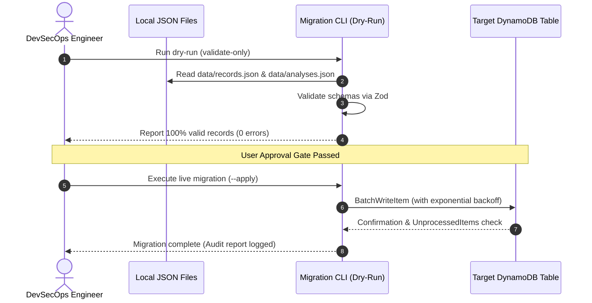

# Waste2Watt — Database Migration & Data Evolution Design

This document details the migration methodology for transitioning Waste2Watt from local single-user JSON files to high-performance, multi-tenant Amazon DynamoDB for cloud staging.

---

## 1. Migration Overview & Guarantees

1. **Zero Data Loss**: All existing waste records, historical deterministic analysis snapshots, and factor records are preserved verbatim.
2. **Stable Identifiers & Timestamps**: Existing IDs (`rec-...`, `ana-...`, `FAC-...`) and ISO-8601 timestamps are retained as canonical immutable identifiers.
3. **Repository Interface Compatibility**: The application code interacts solely with `IWasteRecordRepository`, `IFactorRepository`, and `IAnalysisRepository`. Switching between `FileRepositories` and `DynamoRepositories` is an environment-driven dependency injection change (`STORAGE_TYPE=dynamo`).
4. **Validation Prior to Ingestion**: Every record is validated against its domain Zod schema (`WasteRecordSchema`, `AnalysisResultSchema`, `FactorRecordSchema`) prior to DynamoDB `PutItem`.

---

## 2. Entity Transformation Mappings

### 2.1 Waste Records
```ts
// Local JSON representation
{
  "id": "rec-1774392000-demo1",
  "siteId": "site-campus-01",
  "date": "2026-03-25",
  "category": "prepared_food",
  "massKg": 450,
  "massUnit": "kg",
  "source": "canteen_kitchen",
  "contamination": "clean",
  "provenance": "measured",
  "createdAt": "2026-03-25T10:00:00Z"
}

// DynamoDB Item Mapping
{
  "PK": { "S": "SITE#site-campus-01" },
  "SK": { "S": "REC#2026-03-25#rec-1774392000-demo1" },
  "entityType": { "S": "WasteRecord" },
  "id": { "S": "rec-1774392000-demo1" },
  "siteId": { "S": "site-campus-01" },
  "date": { "S": "2026-03-25" },
  "category": { "S": "prepared_food" },
  "massKg": { "N": "450" },
  "massUnit": { "S": "kg" },
  "source": { "S": "canteen_kitchen" },
  "contamination": { "S": "clean" },
  "provenance": { "S": "measured" },
  "createdAt": { "S": "2026-03-25T10:00:00Z" }
}
```

### 2.2 Factor Constants
```ts
// DynamoDB Item Mapping
{
  "PK": { "S": "SYSTEM#FACTORS" },
  "SK": { "S": "FAC#FAC-CH4-FRACTION" },
  "entityType": { "S": "FactorRecord" },
  "factorId": { "S": "FAC-CH4-FRACTION" },
  "name": { "S": "Methane Fraction in Biogas" },
  "value": { "N": "0.60" },
  "unit": { "S": "fraction (v/v)" },
  "sourceName": { "S": "IEA Bioenergy" },
  "sourceReference": { "S": "Task 37 Energy from Biogas" },
  "effectiveDate": { "S": "2024-01-01" },
  "qualityStatus": { "S": "verified_constant" },
  "notes": { "S": "Representative mid-range value" }
}
```

---

## 3. Migration Execution Procedure



---

## 4. Rollback & Disaster Recovery Strategy

1. **Pre-Migration Snapshot**: The local `./data` folder is archived into a timestamped, checksummed `.tar.gz` archive before any cloud sync.
2. **DynamoDB Point-in-Time Recovery**: Continuous incremental backup is enabled on the DynamoDB table, allowing restoration to any second within the preceding 35 days.
3. **Emergency Downgrade**: If staging encounters issues, setting `STORAGE_TYPE=file` instantly reverts the backend to local file persistence with zero code changes.
